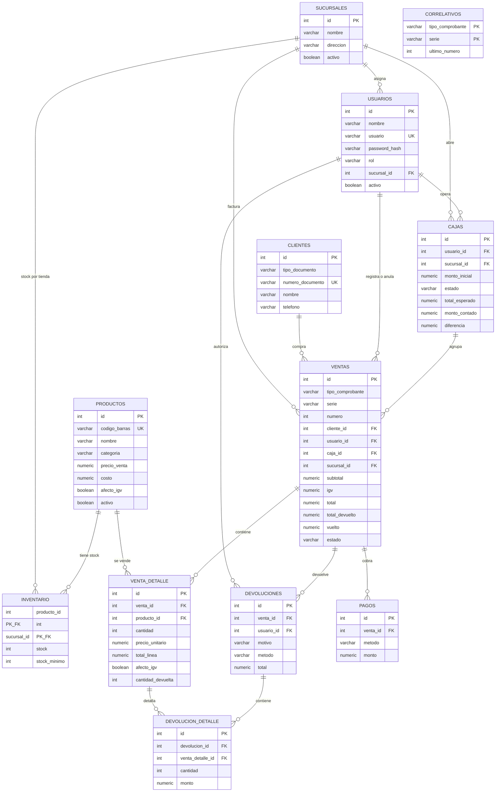
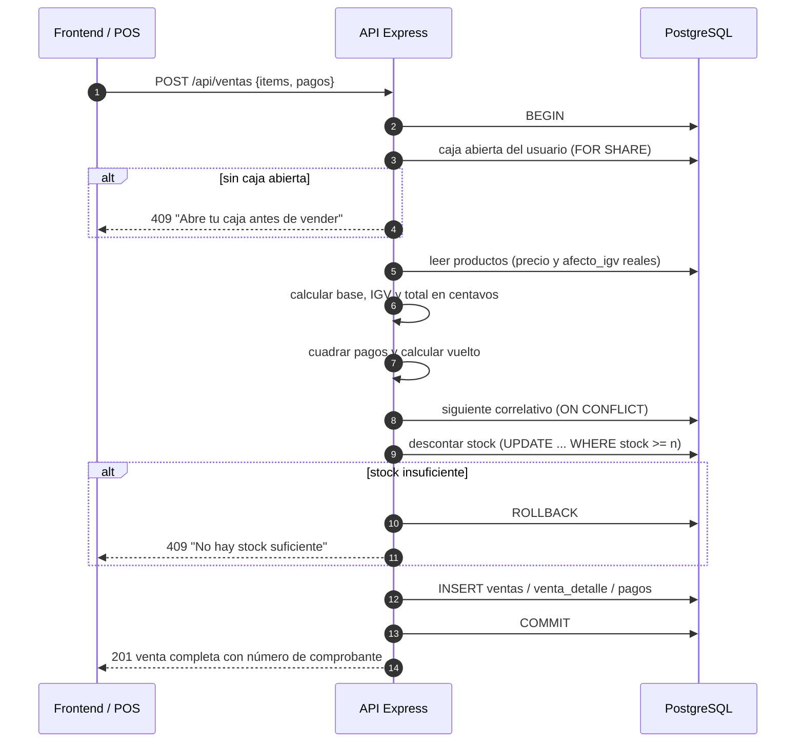

# Diagrama de la base de datos

Base: `ventas_fisicas` (PostgreSQL). 12 tablas.
El objetivo del modelo es que una venta **nunca dependa de datos que cambian**:
precios copiados, stock por sucursal y movimientos registrados, no borrados.

---

## Diagrama entidad-relación



> `CORRELATIVOS` no se conecta con ninguna tabla a propósito: solo guarda el último número
> emitido por tipo y serie. La venta copia ese número; no lo referencia con FK.

---

## Qué es cada tabla y para qué se usa

### 1. `sucursales` — las tiendas

Cada local físico donde se vende. Guarda nombre, dirección y si está activo.

**Uso:** el cajero pertenece a una sucursal; el stock y las ventas se separan por sucursal.
Una venta de Arequipa no puede descontar stock de Yanahuara.

---

### 2. `usuarios` — quién entra al sistema

Personas que usan el POS. `rol` es `cajero` o `administrador`. La contraseña se guarda
**hasheada con bcrypt**, nunca en texto plano.

- `sucursal_id` es obligatorio para un cajero y opcional para el administrador.
- `activo` permite desactivar sin borrar (borrado lógico): una venta histórica sigue
  apuntando a ese usuario.

**Uso:** login, permisos y dueño de cada caja/venta.

---

### 3. `productos` — el catálogo

Datos comerciales del producto: código de barras, nombre, marca, categoría, presentación,
unidad de medida, **precio de venta**, costo y `afecto_igv`.

- `precio_venta` **incluye IGV** (así se muestra en la tienda).
- `afecto_igv = false` para alimentos exonerados (arroz, pan, leche).
- `activo` permite retirarlo del catálogo sin romper ventas antiguas.

**Uso:** el POS busca el producto, pero el backend lee el precio desde acá. El frontend no
puede imponer un precio.

---

### 4. `inventario` — stock por producto y sucursal

El stock **no** es una columna de `productos` porque un mismo producto tiene distinto stock
en cada tienda. La llave primaria es compuesta: `(producto_id, sucursal_id)`.

- `stock`: unidades disponibles.
- `stock_minimo`: umbral para alertar reposición.

**Uso:** al vender se descuenta con `UPDATE ... WHERE stock >= cantidad`; al devolver o anular
se repone. El ajuste manual fija el valor contado (conteo físico), no suma ni resta.

---

### 5. `clientes` — compradores

Documento (DNI de 8 dígitos o RUC de 11), nombre y teléfono. `numero_documento` es único.

**Uso:** una venta puede no tener cliente (venta al público general, `cliente_id NULL`).
La **factura** exige un cliente con RUC. No hay borrado: la venta histórica lo referencia.

---

### 6. `cajas` — turnos de caja

Cada fila es un turno: apertura con `monto_inicial`, ventas asociadas y cierre con arqueo.

- `estado`: `abierta` o `cerrada`.
- Al cerrar se guardan `total_efectivo`, `total_esperado`, `monto_contado` y `diferencia`.

Un índice único parcial garantiza **una sola caja abierta por usuario**:

```sql
CREATE UNIQUE INDEX ux_caja_abierta_por_usuario
  ON cajas (usuario_id) WHERE estado = 'abierta';
```

**Uso:** no se vende sin caja abierta; la venta hereda `caja_id` y `sucursal_id`.

---

### 7. `correlativos` — numeración de comprobantes

Llave compuesta `(tipo_comprobante, serie)` y `ultimo_numero`. Series: `T001`, `B001`, `F001`.

**Uso:** cada venta pide el siguiente número con una operación atómica:

```sql
INSERT INTO correlativos (tipo_comprobante, serie, ultimo_numero)
VALUES ($1, $2, 1)
ON CONFLICT (tipo_comprobante, serie)
DO UPDATE SET ultimo_numero = correlativos.ultimo_numero + 1
RETURNING ultimo_numero;
```

Dos cajeros vendiendo a la vez no pueden repetir número.

---

### 8. `ventas` — cabecera del comprobante

Una fila por venta: tipo, serie, número, cliente, cajero, caja, sucursal, totales y estado.

- `subtotal` = base imponible (sin IGV).
- `igv` = impuesto del período.
- `total` = lo que paga el cliente (con IGV).
- `vuelto` = cambio entregado.
- `total_devuelto` = acumulado de devoluciones parciales.
- `estado`: `emitida` o `anulada`, con `motivo_anulacion`, `anulada_por` y `anulada_en`.

**Uso:** es el centro del modelo. Todo reporte parte de acá filtrando `estado = 'emitida'`.
El total original no se modifica: `neto = total - total_devuelto`.

---

### 9. `venta_detalle` — ítems vendidos

Una fila por producto dentro de la venta. Guarda **snapshot** del precio y del IGV:

- `precio_unitario` y `total_linea` copiados al momento de vender.
- `afecto_igv` copiado del producto.
- `cantidad_devuelta` acumula lo devuelto (nunca supera `cantidad`, lo exige un CHECK).

**Uso:** reimprimir el ticket con los precios de ayer aunque el producto haya cambiado hoy.
Es también la base del reporte de productos más vendidos.

---

### 10. `pagos` — cómo pagó el cliente

Una venta puede tener varios pagos (efectivo + tarjeta, por ejemplo).

- `metodo`: `efectivo`, `tarjeta` o `billetera`.
- `monto`: **monto aplicado** a la venta, no el billete recibido.

**Uso:** el arqueo suma solo `metodo = 'efectivo'`. Si el cliente pagó 20 por un total de
13.50, acá se guarda 13.50 y el vuelto de 6.50 va en `ventas.vuelto`.

---

### 11. `devoluciones` — cabecera de una devolución

Registra el hecho: venta, usuario que autoriza, motivo, método de reembolso y total.

- `metodo`: `efectivo`, `tarjeta` o `billetera`.
- Solo las devoluciones en **efectivo** restan del efectivo esperado de la caja.

**Uso:** auditoría. Nada se borra: si un cliente devuelve un producto, queda el registro.

---

### 12. `devolucion_detalle` — qué se devolvió

Una fila por ítem devuelto: `venta_detalle_id`, cantidad y monto.

**Uso:** permite devoluciones parciales (1 de 2 arroces) y saber exactamente qué volvió al stock.

---

## Cómo se conectan (resumen)

```
sucursales ──< usuarios
sucursales ──< inventario >── productos
sucursales ──< cajas >── usuarios
sucursales ──< ventas
clientes   ──< ventas
cajas      ──< ventas
usuarios   ──< ventas
ventas     ──< venta_detalle >── productos
ventas     ──< pagos
ventas     ──< devoluciones >── usuarios
devoluciones ──< devolucion_detalle >── venta_detalle
```

---

## Flujo de una venta (lo que se muestra en la defensa)



---

## Decisiones de diseño que conviene defender

| Decisión | Por qué |
|---|---|
| Stock en tabla aparte | Un producto tiene distinto stock por sucursal |
| Precio copiado en `venta_detalle` | Una venta pasada no debe cambiar si sube el precio |
| `pagos.monto` = monto aplicado | El arqueo cuenta lo que queda en el cajón, no el billete recibido |
| Índice único parcial en `cajas` | La base impide dos cajas abiertas; un `if` en el código se puede colar |
| Correlativo con `ON CONFLICT` | Numeración atómica sin repetir ni bloquear de más |
| `total_devuelto` separado de `total` | Se conserva el comprobante original y se calcula el neto |
| Borrado lógico | Las ventas históricas necesitan seguir apuntando a productos y usuarios |
| Dinero en `NUMERIC(10,2)` | Precisión exacta; el código además calcula en centavos enteros |
