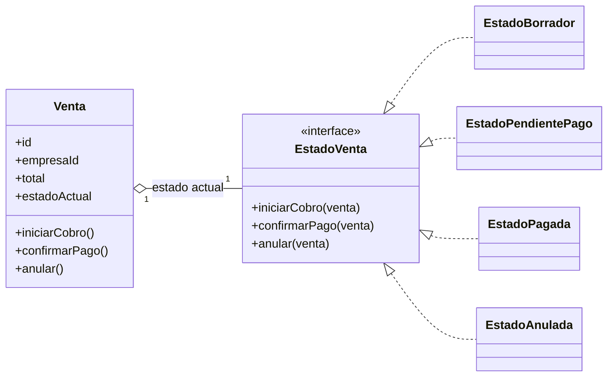
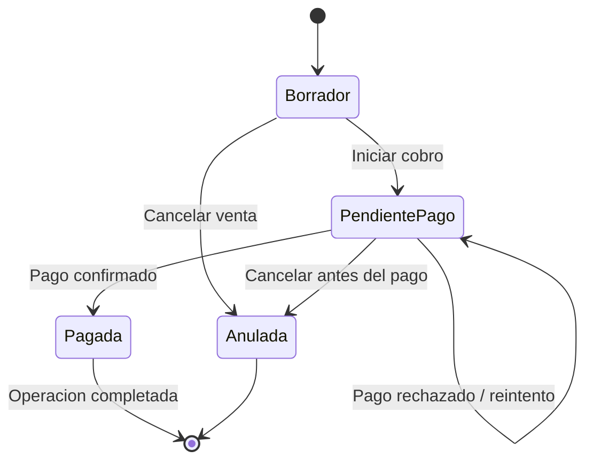
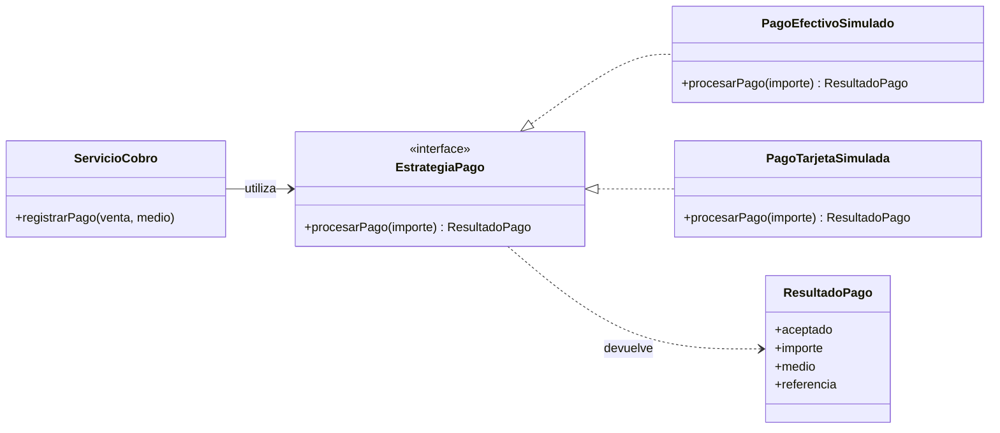
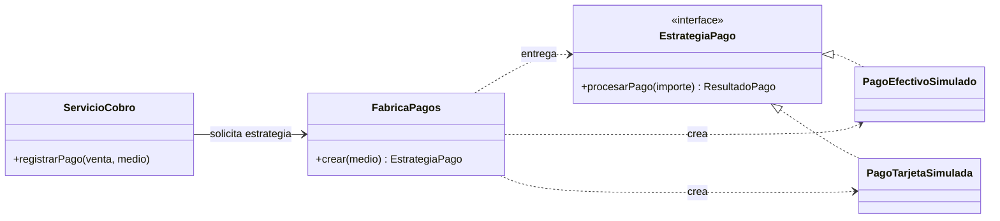
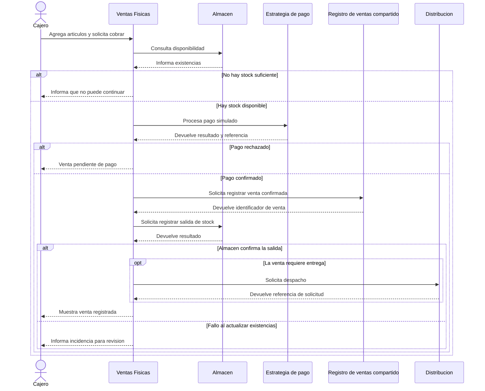

# Diagramas UML propuestos para Ventas Físicas

**Proyecto:** ERP académico UNSA — módulo de Ventas Físicas  
**Responsabilidad:** Patrones de Objetos  
**Estado:** Diagramas conceptuales sujetos a revisión

## 1. Introducción

Los siguientes diagramas representan una posible aplicación de los patrones *State* y *Strategy*, con una fábrica simple como apoyo. Su objetivo es comunicar cómo se podrían repartir las responsabilidades dentro del punto de venta, no describir clases que ya estén implementadas.

Los diagramas están escritos en **Mermaid**, que GitHub puede mostrar directamente al abrir este archivo Markdown. Los nombres de clases son referenciales y podrán adaptarse al lenguaje y a la arquitectura que acuerde el equipo.

## 2. Diagrama de clases: State

La clase `Venta` mantiene la información de la operación y delega las reglas de transición en un objeto `EstadoVenta`. Los estados concretos determinan qué acciones son válidas.

**Lectura del diagrama:** `Venta` no necesita repetir las mismas condiciones en todos sus métodos. La decisión sobre si puede cobrarse, confirmarse o cancelarse se concentra en el estado que tiene en ese momento.

## 3. Diagrama de estados: recorrido de una venta

El siguiente recorrido es una propuesta para el prototipo. En particular, **no se está aprobando todavía el momento de descuento de stock ni el procedimiento de devolución**.

**Ejemplo:** si el pago con tarjeta simulada es rechazado, la venta no llega a `Pagada`. Permanece pendiente para que el cajero pueda corregir o cancelar la operación.

## 4. Diagrama de clases: Strategy

`EstrategiaPago` representa una forma común de procesar pagos. Cada implementación aplica sus propias validaciones, pero entrega un resultado comparable.

**Lectura del diagrama:** el servicio que coordina el cobro se comunica con una interfaz común. No tiene que implementar dentro de sí mismo todas las reglas de efectivo y tarjeta. El resultado retornado no modifica por sí solo la venta: debe validarlo el flujo encargado de sus estados.

## 5. Diagrama de clases: fábrica simple de pagos (opcional)

La fábrica simple tiene un trabajo concreto: seleccionar una implementación de `EstrategiaPago` según el medio elegido.

**Aclaración:** esta es una representación de *fábrica simple*, no del patrón *Factory Method* en su estructura formal. Si al implementar no aporta claridad, se puede prescindir de ella.

## 6. Diagrama de secuencia: ejemplo de venta en caja

Este diagrama integra las ideas anteriores en un caso sencillo. Los nombres de los participantes representan responsabilidades, **no servicios o endpoints que ya existan**. Se muestra una posible secuencia de integración, pendiente de confirmar con Backend, Almacén y Ventas Virtuales.

**Importante:** el orden exacto de confirmación de la venta y descuento de existencias no está cerrado en los documentos del proyecto. El diagrama es un punto de partida para discutirlo; no supone que las llamadas sean transaccionales ni garantiza por sí solo la consistencia entre módulos.

## 7. Relación de los diagramas con las historias de usuario

| Diagrama | Historia o necesidad relacionada |
| --- | --- |
| Clases y transiciones de *State* | HU-02 (armar venta), HU-04 (registrar venta pagada), HU-06 (consultar ventas del día). |
| Clases de *Strategy* | Registro del pago simulado previsto en el alcance inicial. |
| Fábrica simple de pagos | Selección del medio de pago en caja, si el equipo necesita centralizarla. |
| Secuencia de venta | HU-01 (disponibilidad), HU-02 (venta), HU-04 (registro común), HU-05 (salida de stock). |

## 8. Aspectos pendientes de validación

Antes de tomar estos diagramas como definitivos, se debe revisar con el equipo:

- Si los cuatro estados propuestos describen correctamente las reglas acordadas por el Product Owner.
- Cómo se identifica la empresa y se restringe el acceso a operaciones de otras empresas.
- Quién administra el registro de ventas que compartirían Ventas Físicas y Ventas Virtuales.
- Qué respuesta entrega Almacén y en qué momento debe modificar existencias.
- Si Distribución participa en el primer prototipo o solo en una entrega posterior.
- Cómo actuar cuando un pago se confirma pero falla una comunicación posterior.
- Si las clases sugeridas encajan con la tecnología y estructura que defina DevOps/Arquitectura.

## 9. Conclusión

Los diagramas permiten explicar las decisiones de diseño sin depender todavía de un lenguaje de programación. *State* hace visibles las reglas de cambio de una venta; *Strategy* muestra cómo separar las modalidades de pago; y la fábrica simple ejemplifica una selección centralizada cuando sea útil. El diagrama de secuencia recuerda que el resultado final también depende de las integraciones acordadas con los otros módulos. Por esa razón, todos deben revisarse antes de tratarse como diseño definitivo.

### Base documental

- `01_Organizacion_Tribu_Ventas_Fisicas.docx`: alcance y responsabilidades de la tribu.
- `02_Modulos_y_Tablas_Compartidas_Ventas_Fisicas.docx`: datos compartidos y flujo de integración propuesto.
- `03_Propuesta_y_Preguntas_Ventas_Fisicas.docx`: historias de usuario y caso de demostración.
